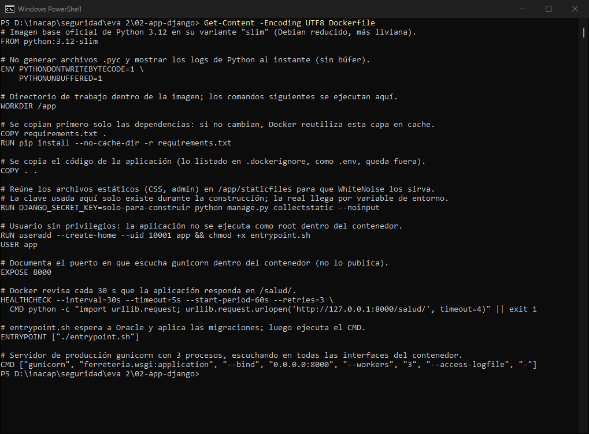
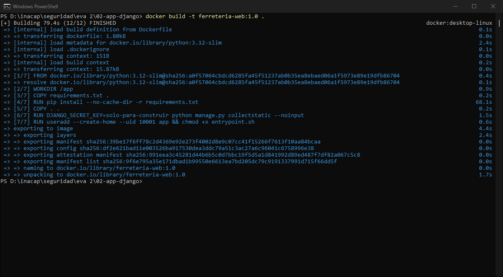
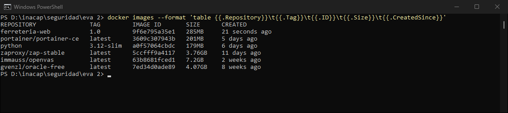
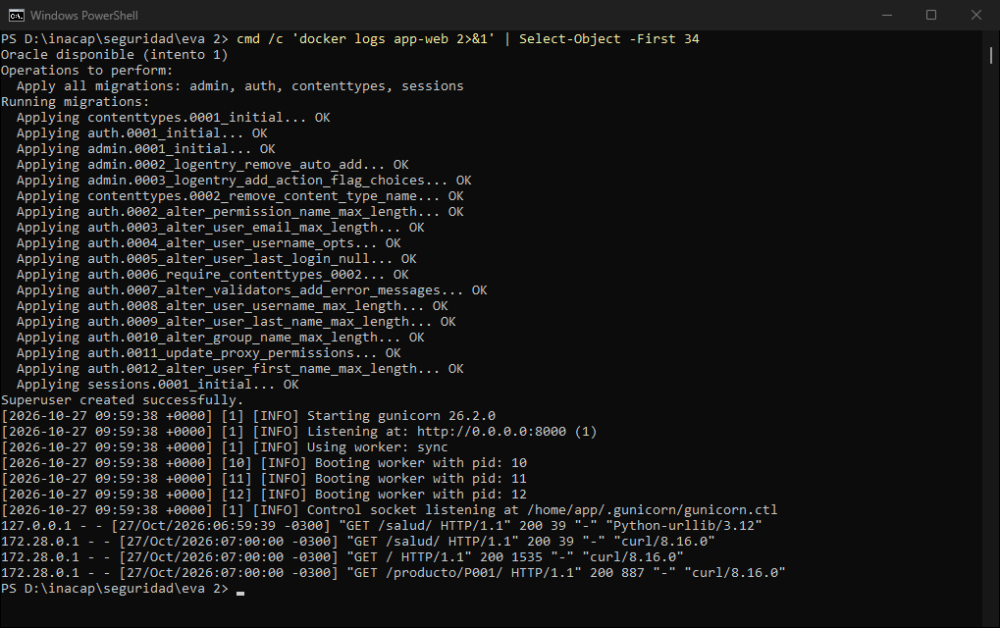
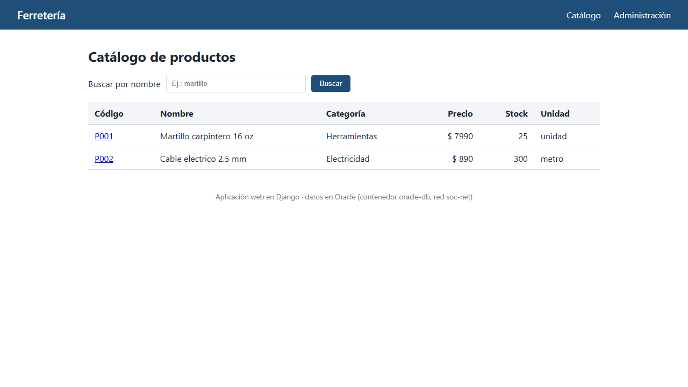

# Investigación: Dockerfile

**Asignatura:** Gestión de Seguridad de la Información (TI3062) — INACAP
**Docente:** Héctor Tejo
**Integrantes:** Benjamín Cifuentes · Benjamín Contesso · Victor Cancino
**Fecha:** 28 de octubre de 2026

> Todas las respuestas se contrastaron con documentación oficial (Docker, Django, python-oracledb y Docker Hub). Las fuentes se citan en formato APA y se listan al final. El ejemplo práctico es la misma aplicación web usada en la Evaluación 2 (carpeta `02-app-django/`), construida y ejecutada en este equipo: las capturas corresponden a esa ejecución real.

---

## Índice

1. [¿Qué es un Dockerfile y para qué se utiliza?](#1-qué-es-un-dockerfile-y-para-qué-se-utiliza)
2. [¿Qué instrucción se utiliza para especificar la imagen base?](#2-qué-instrucción-se-utiliza-para-especificar-la-imagen-base)
3. [¿Cuál es la diferencia entre COPY y ADD?](#3-cuál-es-la-diferencia-entre-copy-y-add)
4. [¿Qué diferencia existe entre RUN, CMD y ENTRYPOINT?](#4-qué-diferencia-existe-entre-run-cmd-y-entrypoint)
5. [¿Qué hace la instrucción WORKDIR y por qué es necesaria?](#5-qué-hace-la-instrucción-workdir-y-por-qué-es-necesaria)
6. [¿Cuál es la diferencia entre ARG y ENV?](#6-cuál-es-la-diferencia-entre-arg-y-env)
7. [¿Qué es un archivo .dockerignore y para qué sirve?](#7-qué-es-un-archivo-dockerignore-y-para-qué-sirve)
8. [¿Por qué se recomienda la forma exec en lugar de la forma shell?](#8-por-qué-se-recomienda-usar-la-forma-exec-comando-arg-en-lugar-de-la-forma-shell)
9. [¿Para qué sirve EXPOSE?](#9-para-qué-sirve-expose)
10. [¿Para qué sirve RUN?](#10-para-qué-sirve-run)
11. [¿Cómo se ejecuta un archivo Dockerfile?](#11-cómo-se-ejecuta-un-archivo-dockerfile)
12. [Ejemplo: Dockerfile de una aplicación Django que se conecta a Oracle en otro contenedor](#12-ejemplo-dockerfile-de-una-aplicación-web-django-python-que-se-conecta-a-oracle-db-en-otro-contenedor)
13. [Referencias](#referencias)

---

## 1. ¿Qué es un Dockerfile y para qué se utiliza?

Un **Dockerfile** es un archivo de texto plano (sin extensión, llamado `Dockerfile` por convención) que contiene, en orden, todas las instrucciones necesarias para construir una **imagen** de Docker. La documentación oficial lo define como "un documento de texto que contiene todos los comandos que un usuario podría ejecutar en la línea de comandos para ensamblar una imagen" (Docker Inc., s.f.-a).

**Para qué se utiliza:**

- **Automatizar y documentar** cómo se arma el entorno de una aplicación: sistema base, dependencias, código, configuración y comando de inicio.
- **Reproducibilidad:** cualquier persona que tenga el Dockerfile y el código obtiene la misma imagen con `docker build`, sin instalar nada a mano.
- **Versionado:** al ser texto, se guarda junto al código (Git) y los cambios de infraestructura quedan registrados.
- Cada instrucción que modifica el sistema de archivos genera una **capa**; Docker reutiliza (cachea) las capas que no cambian, lo que acelera las construcciones siguientes.

En la Evaluación 2 la aplicación web es la única imagen propia: se construye con un Dockerfile, mientras que Oracle, ZAP y OpenVAS usan imágenes ya publicadas en Docker Hub.

## 2. ¿Qué instrucción se utiliza para especificar la imagen base?

La instrucción **`FROM`**. "Inicializa una nueva etapa de construcción y define la imagen base para las instrucciones siguientes"; un Dockerfile válido debe comenzar con `FROM` (solo puede ir precedida de directivas del analizador, comentarios o `ARG`) (Docker Inc., s.f.-a).

```dockerfile
FROM python:3.12-slim
```

- `python` es el repositorio oficial en Docker Hub y `3.12-slim` es la **etiqueta (tag)**: Python 3.12 sobre Debian reducido (Docker Inc., s.f.-f).
- Buena práctica: usar una etiqueta concreta (nunca dejarla implícita, que equivale a `latest`) o incluso fijar el *digest* (`@sha256:...`) para que la imagen no cambie sin aviso (Docker Inc., s.f.-b). Esto es importante en la gestión de vulnerabilidades: hay que saber exactamente qué versión se está ejecutando para poder evaluarla.

## 3. ¿Cuál es la diferencia entre COPY y ADD?

Ambas copian archivos hacia el sistema de archivos de la imagen, pero **`ADD` tiene funciones extra** (Docker Inc., s.f.-a):

| | `COPY` | `ADD` |
|---|---|---|
| Copiar archivos/carpetas del contexto de construcción | Sí | Sí |
| Descargar desde una URL remota | No | Sí |
| Clonar un repositorio Git | No | Sí |
| Descomprimir automáticamente un `.tar` local | No (lo copia tal cual) | Sí, lo extrae en el destino |

**Recomendación oficial:** preferir `COPY` en la mayoría de los casos, porque es explícito y predecible; usar `ADD` solo cuando se necesita una de sus funciones especiales, como descargar un artefacto remoto durante la construcción (Docker Inc., s.f.-b). Desde el punto de vista de seguridad, `COPY` evita descargas o extracciones inesperadas.

```dockerfile
COPY requirements.txt .        # copia un archivo del proyecto
COPY . .                       # copia todo el contexto (menos lo excluido en .dockerignore)
```

## 4. ¿Qué diferencia existe entre RUN, CMD y ENTRYPOINT?

La diferencia principal es **cuándo** se ejecutan y **para qué** (Docker Inc., s.f.-a):

| Instrucción | ¿Cuándo se ejecuta? | Propósito | Detalle |
|---|---|---|---|
| `RUN` | Durante la **construcción** (`docker build`) | Preparar la imagen: instalar paquetes, crear usuarios, compilar | Cada `RUN` crea una nueva capa |
| `CMD` | Al **iniciar el contenedor** | Comando (o argumentos) **por defecto** | Se reemplaza si se pasan argumentos en `docker run`. Si hay varios `CMD`, solo vale el último |
| `ENTRYPOINT` | Al **iniciar el contenedor** | Ejecutable **principal y fijo**: el contenedor "se comporta como" ese programa | No se reemplaza con argumentos de `docker run` (solo con `--entrypoint`) |

**Cómo se combinan:** si existen ambos en forma exec, `CMD` pasa a ser la lista de argumentos de `ENTRYPOINT`. Por ejemplo, `ENTRYPOINT ["exec_entry", "p1_entry"]` + `CMD ["exec_cmd", "p1_cmd"]` ejecuta `exec_entry p1_entry exec_cmd p1_cmd` (Docker Inc., s.f.-a).

En el ejemplo de la sección 12 se usa justamente esa combinación:

```dockerfile
ENTRYPOINT ["./entrypoint.sh"]            # siempre se ejecuta: espera a Oracle y aplica migraciones
CMD ["gunicorn", "ferreteria.wsgi:application", "--bind", "0.0.0.0:8000", ...]   # comando por defecto
```

`entrypoint.sh` termina con `exec "$@"`, que reemplaza el script por el `CMD` (gunicorn). La documentación recomienda este patrón: `exec` permite que la aplicación final sea el **PID 1** del contenedor (Docker Inc., s.f.-b).

## 5. ¿Qué hace la instrucción WORKDIR y por qué es necesaria?

`WORKDIR` **define el directorio de trabajo** para las instrucciones `RUN`, `CMD`, `ENTRYPOINT`, `COPY` y `ADD` que vienen después. Si el directorio no existe, Docker lo **crea** automáticamente. Una ruta relativa se interpreta respecto del `WORKDIR` anterior (Docker Inc., s.f.-a).

**Por qué es necesaria:**

- Sin `WORKDIR`, los comandos se ejecutan en el directorio que traiga la imagen base (a menudo `/`), y los archivos podrían quedar mezclados con los del sistema. La documentación lo indica como buena práctica: definirlo explícitamente "para evitar operaciones no deseadas en directorios desconocidos" (Docker Inc., s.f.-a).
- Reemplaza el uso de `RUN cd ...`, que no persiste entre instrucciones y es difícil de leer y mantener. Se recomienda usar **rutas absolutas** (Docker Inc., s.f.-b).

```dockerfile
WORKDIR /app     # a partir de aquí, COPY . . copia en /app y el CMD se ejecuta en /app
```

## 6. ¿Cuál es la diferencia entre ARG y ENV?

| | `ARG` | `ENV` |
|---|---|---|
| Disponible durante `docker build` | Sí | Sí |
| Disponible en el contenedor en ejecución | **No** | **Sí** |
| Cómo se le da valor | `docker build --build-arg NOMBRE=valor` | En el Dockerfile; se puede sobrescribir con `docker run -e` o `environment:` en Compose |
| Queda guardado en la imagen | No como variable de entorno | Sí, persiste en la imagen |

Según la documentación, `ARG` define una variable que se pasa al construir y "no queda incorporada en la imagen ni disponible en el contenedor final", mientras que `ENV` "persiste cuando se ejecuta un contenedor a partir de la imagen resultante" (Docker Inc., s.f.-a).

**Advertencia de seguridad:** no se recomienda usar `ARG` (ni `ENV`) para secretos como contraseñas o tokens (Docker Inc., s.f.-a). Por eso, en el ejemplo, las credenciales de Oracle **no** están en el Dockerfile: llegan en tiempo de ejecución desde un archivo `.env` que Compose carga con `env_file`, y ese archivo está excluido de la imagen con `.dockerignore`.

```dockerfile
ARG PYTHON_VERSION=3.12                  # solo existe mientras se construye
ENV PYTHONUNBUFFERED=1                   # existe también dentro del contenedor
```

## 7. ¿Qué es un archivo .dockerignore y para qué sirve?

Es un archivo de texto ubicado en la **raíz del contexto de construcción** que lista, con patrones similares a los de la shell de Unix (por ejemplo `*.pyc`, `**/*.log`, `!README.md`), los archivos y carpetas que se deben **excluir del contexto** que se envía al constructor (Docker Inc., s.f.-c).

**Para qué sirve:**

- **Velocidad:** se envían menos archivos al constructor y la construcción es más rápida (Docker Inc., s.f.-c).
- **Imágenes más livianas y limpias:** `COPY . .` no arrastra cachés, entornos virtuales ni archivos temporales.
- **Seguridad:** evita que secretos como `.env`, claves o la carpeta `.git` terminen dentro de una imagen que podría publicarse.
- **Mejor uso de la cache:** cambios en archivos irrelevantes no invalidan las capas.

`.dockerignore` del ejemplo:

```text
.env
.env.*
docker-compose.yml
__pycache__/
*.pyc
staticfiles/
.git
```

## 8. ¿Por qué se recomienda usar la forma exec `["comando", "arg"]` en lugar de la forma shell?

`RUN`, `CMD` y `ENTRYPOINT` aceptan dos formas (Docker Inc., s.f.-a):

- **Forma shell:** `CMD gunicorn ferreteria.wsgi:application` → Docker la ejecuta a través de `/bin/sh -c "..."`.
- **Forma exec:** `CMD ["gunicorn", "ferreteria.wsgi:application"]` → Docker ejecuta el programa **directamente**, sin shell.

**Por qué se prefiere la forma exec:**

1. **Señales y apagado ordenado:** con la forma exec el programa es el **PID 1** del contenedor y recibe directamente la señal `SIGTERM` que envía `docker stop`, de modo que puede cerrar conexiones y terminar limpiamente. Con la forma shell, el PID 1 es `sh`, que no reenvía la señal; Docker espera el tiempo de gracia y termina el proceso a la fuerza (Docker Inc., s.f.-a; Docker Inc., s.f.-b).
2. **Sin interpretación de la shell:** se evita el "procesamiento de cadenas" de la shell (expansión de variables, comillas, espacios), por lo que los argumentos llegan exactamente como se escribieron (Docker Inc., s.f.-a).
3. **Combinación con ENTRYPOINT:** si `ENTRYPOINT` está en forma shell, ignora el `CMD` y los argumentos de `docker run` (Docker Inc., s.f.-a); en forma exec ambos se combinan como se explicó en la pregunta 4.
4. No depende de que la imagen tenga una shell (útil en imágenes mínimas).

## 9. ¿Para qué sirve EXPOSE?

`EXPOSE` **documenta** en qué puerto(s) escucha la aplicación dentro del contenedor. **No publica** el puerto: "funciona como una forma de documentación" entre quien construye la imagen y quien la ejecuta (Docker Inc., s.f.-a).

Para que el puerto sea accesible desde el equipo anfitrión hay que publicarlo al ejecutar:

- `docker run -p 8088:8000 ...` (puerto del host : puerto del contenedor), o
- en Compose: `ports: - "8088:8000"`, o
- `docker run -P`, que publica todos los puertos declarados con `EXPOSE` en puertos aleatorios del host.

En el ejemplo, `EXPOSE 8000` documenta el puerto de gunicorn y el `docker-compose.yml` lo publica como `8088:8000`. Dentro de la red `soc-net`, ZAP y OpenVAS llegan a la aplicación por `172.28.0.20:8000` (puerto interno), sin pasar por el 8088 del host.

## 10. ¿Para qué sirve RUN?

`RUN` **ejecuta un comando durante la construcción de la imagen** y guarda el resultado como una **nueva capa** (Docker Inc., s.f.-a). Se usa para preparar el entorno:

- instalar dependencias (`pip install`, `apt-get install`),
- crear usuarios y permisos,
- compilar o generar archivos (por ejemplo, `collectstatic` de Django).

Lo que hace `RUN` queda "congelado" en la imagen; no se vuelve a ejecutar al iniciar el contenedor (para eso están `CMD` y `ENTRYPOINT`).

Buenas prácticas: encadenar comandos relacionados con `&&` para no crear capas innecesarias, limpiar cachés en el mismo `RUN` (`pip install --no-cache-dir`) y ordenar las instrucciones de lo que menos cambia a lo que más cambia para aprovechar la cache (Docker Inc., s.f.-b).

```dockerfile
RUN pip install --no-cache-dir -r requirements.txt
RUN useradd --create-home --uid 10001 app && chmod +x entrypoint.sh
```

## 11. ¿Cómo se ejecuta un archivo Dockerfile?

Un Dockerfile no se "ejecuta" directamente: se **construye** una imagen con él y luego se **ejecuta un contenedor** a partir de esa imagen.

**Paso 1 — Construir la imagen** (desde la carpeta donde está el Dockerfile):

```bash
docker build -t ferreteria-web:1.0 .
```

- `-t nombre:etiqueta` da nombre y versión a la imagen.
- `.` es el **contexto de construcción**: la carpeta cuyos archivos pueden usar `COPY` y `ADD` (Docker Inc., s.f.-c).
- Con `-f ruta/OtroDockerfile` se puede indicar un Dockerfile con otro nombre o ubicación (Docker Inc., s.f.-d).

**Paso 2 — Verificar la imagen:** `docker images`

**Paso 3 — Ejecutar el contenedor**, de dos formas:

```bash
# a) Comando suelto (no recomendado por el profesor: la configuración no queda guardada)
docker run -d --name app-web -p 8088:8000 --env-file .env --network soc-net ferreteria-web:1.0

# b) Con Docker Compose (forma usada en la evaluación: la configuración queda en docker-compose.yml)
docker compose up -d
```

**Paso 4 — Comprobar:** `docker ps`, `docker logs app-web` y abrir `http://localhost:8088`.

---

## 12. Ejemplo: Dockerfile de una aplicación web Django (Python) que se conecta a Oracle DB en otro contenedor

### 12.1 Arquitectura

```text
                         red Docker "soc-net" (172.28.0.0/16)
 ┌───────────────────────────────┐            ┌────────────────────────────────┐
 │ app-web  (172.28.0.20)        │   SQL      │ oracle-db  (172.28.0.3)        │
 │ imagen propia ferreteria-web  │ ─────────► │ imagen gvenzl/oracle-free      │
 │ Django 5.2 + gunicorn :8000   │  :1521     │ servicio FREEPDB1              │
 └──────────────┬────────────────┘            └────────────────────────────────┘
                │ publicado 8088:8000
          http://localhost:8088
```

- Cada contenedor tiene su propio `docker-compose.yml` y ambos se unen a la red externa `soc-net`.
- Dentro de la red, Django llega a Oracle por el **nombre del contenedor** (`oracle-db`), que Docker resuelve con su DNS interno.

### 12.2 Datos de la aplicación (lo que se le entregó a la IA para generar el Dockerfile)

| Dato | Valor |
|---|---|
| Lenguaje | Python 3.12 |
| Framework | Django 5.2 (versión LTS) |
| Driver de Oracle | `oracledb` en **modo Thin** (no necesita instalar Oracle Instant Client) (Oracle, s.f.) |
| Servidor de aplicación | gunicorn |
| Archivos estáticos | WhiteNoise |
| Base de datos | Oracle Database Free en el contenedor `oracle-db`, servicio `FREEPDB1` |

`requirements.txt` (versión 1.1 de la imagen):

```text
Django==5.2.18
oracledb==4.0.2
gunicorn==26.2.0
whitenoise==6.12.0
```

> **Hallazgo de la verificación:** la primera versión de la imagen (`ferreteria-web:1.0`) usaba `oracledb==26.0.1`. Al contrastar con la documentación oficial se comprobó que Django 5.2 declara compatibilidad con `oracledb` desde la versión 2.3.0 hasta la 4.0.2 (Django Software Foundation, s.f.). La aplicación funcionaba, pero la combinación quedaba fuera del rango soportado, así que se registró como hallazgo en el informe y se corrigió: se fijó `oracledb==4.0.2`, se construyó `ferreteria-web:1.1` y se volvió a escanear. Es un ejemplo del ciclo de gestión de vulnerabilidades: las dependencias se revisan y se corrigen de forma continua.

### 12.3 Dockerfile comentado

```dockerfile
# Imagen base oficial de Python 3.12 en su variante "slim" (Debian reducido, más liviana).
FROM python:3.12-slim

# No generar archivos .pyc y mostrar los logs de Python al instante (sin búfer).
ENV PYTHONDONTWRITEBYTECODE=1 \
    PYTHONUNBUFFERED=1

# Directorio de trabajo dentro de la imagen; los comandos siguientes se ejecutan aquí.
WORKDIR /app

# Se copian primero solo las dependencias: si no cambian, Docker reutiliza esta capa en cache.
COPY requirements.txt .
RUN pip install --no-cache-dir -r requirements.txt

# Se copia el código de la aplicación (lo listado en .dockerignore, como .env, queda fuera).
COPY . .

# Reúne los archivos estáticos (CSS, admin) en /app/staticfiles para que WhiteNoise los sirva.
# La clave usada aquí solo existe durante la construcción; la real llega por variable de entorno.
RUN DJANGO_SECRET_KEY=solo-para-construir python manage.py collectstatic --noinput

# Usuario sin privilegios: la aplicación no se ejecuta como root dentro del contenedor.
RUN useradd --create-home --uid 10001 app && chmod +x entrypoint.sh
USER app

# Documenta el puerto en que escucha gunicorn dentro del contenedor (no lo publica).
EXPOSE 8000

# Docker revisa cada 30 s que la aplicación responda en /salud/.
HEALTHCHECK --interval=30s --timeout=5s --start-period=60s --retries=3 \
  CMD python -c "import urllib.request; urllib.request.urlopen('http://127.0.0.1:8000/salud/', timeout=4)" || exit 1

# entrypoint.sh espera a Oracle y aplica las migraciones; luego ejecuta el CMD.
ENTRYPOINT ["./entrypoint.sh"]

# Servidor de producción gunicorn con 3 procesos, escuchando en todas las interfaces del contenedor.
CMD ["gunicorn", "ferreteria.wsgi:application", "--bind", "0.0.0.0:8000", "--workers", "3", "--access-logfile", "-"]
```

**Explicación instrucción por instrucción:**

| # | Instrucción | Qué hace | Pregunta relacionada |
|---|---|---|---|
| 1 | `FROM python:3.12-slim` | Imagen base oficial con Python 3.12. `oracledb` en modo Thin no requiere librerías de Oracle, por eso basta la variante `slim` | 2 |
| 2 | `ENV ...` | Variables que también existirán en el contenedor (logs inmediatos, sin `.pyc`) | 6 |
| 3 | `WORKDIR /app` | Fija y crea el directorio de trabajo | 5 |
| 4 | `COPY requirements.txt .` + `RUN pip install ...` | Instala dependencias en una capa propia que se reutiliza mientras `requirements.txt` no cambie | 3, 10 |
| 5 | `COPY . .` | Copia el código; `.dockerignore` deja fuera `.env` y cachés | 3, 7 |
| 6 | `RUN ... collectstatic` | Genera los archivos estáticos durante la construcción | 10 |
| 7 | `RUN useradd ...` + `USER app` | Crea y usa un usuario sin privilegios (buena práctica de seguridad) (Docker Inc., s.f.-b) | 10 |
| 8 | `EXPOSE 8000` | Documenta el puerto interno | 9 |
| 9 | `HEALTHCHECK` | Docker marca el contenedor como `healthy` o `unhealthy` según `/salud/`, que además consulta Oracle | — |
| 10 | `ENTRYPOINT [...]` | Script de arranque fijo, en forma exec | 4, 8 |
| 11 | `CMD [...]` | Comando por defecto (gunicorn) que el `ENTRYPOINT` ejecuta al final con `exec "$@"` | 4, 8 |

### 12.4 Script de arranque `entrypoint.sh`

Como Oracle se levanta con **otro** `docker-compose.yml`, no se puede usar `depends_on` para esperar a la base de datos. El script lo resuelve:

```sh
#!/bin/sh
set -e
# 1) Esperar a que Oracle acepte conexiones (hasta 60 intentos de 5 s)
python - <<'EOF'
import os, sys, time
import oracledb
for intento in range(1, 61):
    try:
        oracledb.connect(user=os.environ["ORACLE_USER"], password=os.environ["ORACLE_PASSWORD"],
                         dsn=os.environ["ORACLE_DSN"]).close()
        print(f"Oracle disponible (intento {intento})", flush=True)
        break
    except Exception as e:
        print(f"Esperando a Oracle (intento {intento}): {e}", flush=True)
        time.sleep(5)
else:
    sys.exit("Oracle no respondió en 5 minutos")
EOF
# 2) Tablas propias de Django (usuarios, sesiones, admin)
python manage.py migrate --noinput
# 3) Superusuario del admin (solo la primera vez)
if [ -n "$DJANGO_SUPERUSER_USERNAME" ]; then
    python manage.py createsuperuser --noinput 2>/dev/null || echo "El superusuario ya existe"
fi
# 4) Reemplazar este proceso por el CMD (gunicorn), que pasa a ser el PID 1
exec "$@"
```

> El archivo debe tener fin de línea **LF** (formato Unix). Si se guarda con CRLF (Windows), el contenedor falla al iniciar.

### 12.5 Conexión de Django con Oracle (`ferreteria/settings.py`)

```python
DATABASES = {
    "default": {
        "ENGINE": "django.db.backends.oracle",
        "NAME": os.environ.get("ORACLE_DSN", ""),        # "oracle-db:1521/FREEPDB1"
        "USER": os.environ.get("ORACLE_USER", ""),
        "PASSWORD": os.environ.get("ORACLE_PASSWORD", ""),
        "HOST": "",
        "PORT": "",
    }
}
```

- Se usa una cadena **Easy Connect** (`host:puerto/servicio`) en `NAME`, dejando `HOST` y `PORT` vacíos. La documentación de Django indica que este formato es necesario para bases de datos *pluggable* (como `FREEPDB1`) sin `tnsnames.ora`; si se llenan `HOST` y `PORT`, Django arma un descriptor distinto y trata `NAME` como SID (Django Software Foundation, s.f.).
- `oracle-db` es el nombre del contenedor de Oracle: el DNS interno de la red `soc-net` lo traduce a su IP.
- Las tablas `CATEGORIA` y `PRODUCTO` ya existen en Oracle (creadas con `01-oracle/sql/01_tablas.sql`), por eso los modelos de Django usan `managed = False`.

### 12.6 `docker-compose.yml` de la aplicación

```yaml
services:
  app-web:
    image: ferreteria-web:1.1           # imagen local (no existe en Docker Hub); 1.1 = mitigaciones
    container_name: app-web
    restart: unless-stopped
    ports:
      - "8088:8000"                     # host:contenedor (gunicorn escucha en 8000)
    env_file: .env                      # secretos y conexión a Oracle fuera del compose
    networks:
      soc-net:
        ipv4_address: 172.28.0.20       # IP fija: objetivo estable para ZAP y OpenVAS

networks:
  soc-net:
    external: true
```

Variables del archivo `.env` (se entrega solo la plantilla `.env.example`, sin valores reales):

```text
DJANGO_SECRET_KEY=generar-una-clave-larga-y-aleatoria
DJANGO_DEBUG=0
DJANGO_ALLOWED_HOSTS=localhost,127.0.0.1,172.28.0.20,app-web
DJANGO_CSRF_TRUSTED_ORIGINS=http://localhost:8088,http://127.0.0.1:8088
ORACLE_DSN=oracle-db:1521/FREEPDB1
ORACLE_USER=usuario
ORACLE_PASSWORD=contrasena-del-usuario-oracle
DJANGO_SUPERUSER_USERNAME=admin
DJANGO_SUPERUSER_EMAIL=admin@ferreteria.local
DJANGO_SUPERUSER_PASSWORD=contrasena-robusta
```

### 12.7 Paso a paso de la ejecución (realizado el 27-10-2026)

1. **Crear la red externa** (una sola vez):
   ```bash
   docker network create --driver bridge --subnet 172.28.0.0/16 soc-net
   ```
2. **Levantar Oracle** (carpeta `01-oracle`): `docker compose up -d` y esperar `DATABASE IS READY TO USE!`.
3. **Crear las tablas** con el usuario de aplicación:
   ```powershell
   Get-Content sql\01_tablas.sql | docker exec -i oracle-db sqlplus -s usuario/<clave>@//localhost:1521/FREEPDB1
   ```
4. **Construir la imagen** (carpeta `02-app-django`):
   ```bash
   docker build -t ferreteria-web:1.0 .
   ```
   Resultado: 12 de 12 pasos en 79 s; imagen de 285 MB.
5. **Levantar la aplicación:** `docker compose up -d`
6. **Revisar los logs:** `docker logs app-web` → "Oracle disponible", migraciones aplicadas y gunicorn escuchando en `0.0.0.0:8000`.
7. **Probar:** `http://localhost:8088` muestra los productos leídos desde Oracle, y `http://localhost:8088/salud/` responde `{"estado": "ok", "base_de_datos": "ok"}`.
8. **Nueva versión tras mitigar:** se agregó la cabecera Content-Security-Policy, se desactivó el CORS permisivo de WhiteNoise y se fijó `oracledb==4.0.2`; luego se ejecutó `docker build -t ferreteria-web:1.1 .` (27 s, reutilizando capas en caché), se cambió la etiqueta en el compose y se ejecutó otra vez `docker compose up -d`. Cambiar la etiqueta en vez de sobrescribir `1.0` permite volver a la versión anterior si algo falla.

### 12.8 Evidencias



*Figura 1. Dockerfile comentado de la aplicación Django.*



*Figura 2. Construcción de la imagen con `docker build -t ferreteria-web:1.0 .`.*



*Figura 3. `docker images`: la imagen propia `ferreteria-web:1.0` junto a las descargadas.*



*Figura 4. Logs del contenedor: espera a Oracle, migraciones y arranque de gunicorn.*



*Figura 5. Aplicación en `http://localhost:8088` con datos leídos desde Oracle.*

---

## Referencias

Django Software Foundation. (s.f.). *Databases: Oracle notes* (Django 5.2). Recuperado el 27 de octubre de 2026, de https://docs.djangoproject.com/en/5.2/ref/databases/

Docker Inc. (s.f.-a). *Dockerfile reference*. Recuperado el 27 de octubre de 2026, de https://docs.docker.com/reference/dockerfile/

Docker Inc. (s.f.-b). *Building best practices*. Recuperado el 27 de octubre de 2026, de https://docs.docker.com/build/building/best-practices/

Docker Inc. (s.f.-c). *Build context*. Recuperado el 27 de octubre de 2026, de https://docs.docker.com/build/concepts/context/

Docker Inc. (s.f.-d). *docker buildx build*. Recuperado el 27 de octubre de 2026, de https://docs.docker.com/reference/cli/docker/buildx/build/

Docker Inc. (s.f.-e). *Docker Compose*. Recuperado el 27 de octubre de 2026, de https://docs.docker.com/compose/

Docker Inc. (s.f.-f). *python — Docker Official Image*. Docker Hub. Recuperado el 27 de octubre de 2026, de https://hub.docker.com/_/python

Oracle. (s.f.). *Initializing python-oracledb*. python-oracledb documentation. Recuperado el 27 de octubre de 2026, de https://python-oracledb.readthedocs.io/en/latest/user_guide/initialization.html

Venzl, G. (s.f.). *gvenzl/oracle-free*. Docker Hub. Recuperado el 27 de octubre de 2026, de https://hub.docker.com/r/gvenzl/oracle-free
